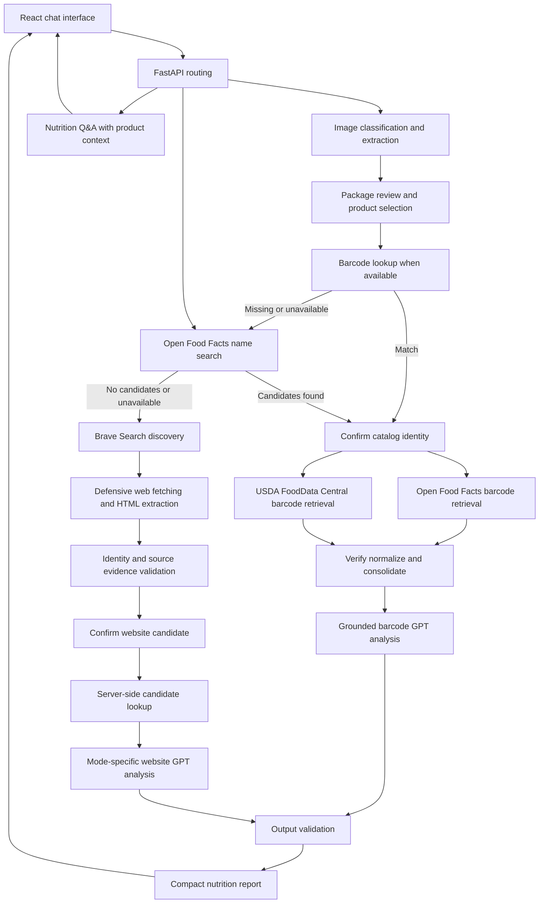

# NutriLens AI 🥗

**NutriLens AI** is a React + FastAPI application for identifying packaged foods, retrieving product-specific nutrition facts, and generating AI-assisted nutrition insights. Users can search by product name or upload a food-package image. The application prioritizes **verified product identity and source-grounded nutrition data** over guesses based on similar foods.

> **Development status:** Active development. The core workflows, including image-based product identification, hybrid product discovery, parallel nutrition retrieval, secure website extraction, and AI-powered nutrition analysis, are implemented and locally tested. Cloud deployment, scalability, and multi-user support are planned enhancements.

## Features

- **Hybrid product discovery:** Open Food Facts catalog search first; Brave Search fallback when no catalog candidates are available or the catalog is unavailable.
- **Image recognition:** Classify food-package images and extract visible names, brands, variants, barcodes, ingredients and nutrition labels. Select individual products when multiple packages appear in one image.
- **Identity confirmation:** Review extracted package information, attempt exact-barcode lookup, fall back to name search when needed, and explicitly confirm a catalog or website candidate.
- **Parallel nutrition retrieval:** Retrieve Open Food Facts and USDA FoodData Central records concurrently, verify exact barcode matches, normalize supported nutrients and consolidate with provenance and conflict checks.
- **Website extraction:** Discover product pages, extract HTML and structured product metadata, validate product identity and retain evidence for reported ingredients, nutrients, additives and allergens.
- **Defensive web fetching:** HTTPS-only requests, public-IP checks, DNS pinning, TLS verification, redirect revalidation, bounded fetch attempts, response-size limits, caching and HTTP 429 cooldowns.
- **Grounded AI analysis:** Separate barcode and website analysis paths. Website analysis supports ingredient-only, nutrition-only, combined and limited-data modes, with structured output validation and explicit uncertainty.
- **Allergen classification:** Distinguish declared presence, possible presence, unverified free-from claims and uncertain claims. Missing declarations do not establish safety.
- **Conversational nutrition Q&A:** Route food-related questions and product searches, using confirmed product context and bounded recent conversation history.
- **Compact React interface:** Product selection, nutrition snapshots, expandable tables and source evidence, loading states and graceful analysis failure handling.

## System architecture



Website candidates remain unverified even after user confirmation. Confirmation establishes the user's intended product, not the accuracy of the website's nutrition claims.

## Technology stack

| Layer | Technology |
| --- | --- |
| Frontend | React, Vite, JavaScript, CSS |
| Backend | Python, FastAPI |
| Product catalog | Open Food Facts |
| Additional nutrition source | USDA FoodData Central |
| Web discovery | Brave Search API |
| Web extraction | Beautiful Soup, Python HTTP/TLS and DNS utilities |
| Website AI analysis | OpenAI API (`gpt-4o-mini`) |
| Image extraction | OpenAI API (`gpt-4.1-mini` used in the image-extraction workflow) |
| Grounded nutrition analysis | OpenAI API (`gpt-4o-mini` used in the verified-nutrition workflow) |
| Networking | REST/JSON, multipart uploads, `requests` and `httpx` |
| Nutrition processing | Python normalization, barcode verification, consolidation, and output validation |

## Repository structure

```text
NutriLens-AI/
├── backend/
│   ├── main.py                      # FastAPI routes
│   ├── food_catalog.py              # Catalog search and barcode details
│   ├── vision_service.py            # Image relevance classification
│   ├── product_extraction.py        # Visible package information extraction
│   ├── nutrition_analysis.py        # Image-label analysis workflow
│   ├── nutrition_sources.py         # Parallel OFF / USDA requests
│   ├── nutrition_normalizer.py      # Common nutrient representation
│   ├── nutrition_verifier.py        # Product/barcode verification
│   ├── nutrition_consolidator.py    # Source consolidation
│   ├── nutrition_llm_payload.py     # Grounded LLM input
│   ├── nutrition_llm_analyzer.py    # Structured GPT analysis
│   ├── nutrition_llm_validator.py   # Output validation
│   ├── nutrition_pipeline.py        # End-to-end nutrition workflow
│   ├── secure_web_fetch.py          # Defensive HTTPS fetching and cache
│   ├── web_product_search.py        # Brave Search discovery and ranking
│   ├── web_content_extractor.py    # HTML and structured metadata extraction
│   ├── web_product_validator.py     # Identity and evidence validation
│   ├── web_fallback_pipeline.py     # Website discovery orchestration
│   ├── web_nutrition_pipeline.py    # Candidate cache and website AI analysis
│   └── requirements.txt
├── frontend/
│   ├── src/
│   │   ├── App.jsx                  # Chat, search, image confirmation
│   │   ├── NutritionResult.jsx      # Nutrition and analysis display
│   │   ├── App.css
│   │   ├── index.css
│   │   └── main.jsx
│   └── package.json
├── .gitignore
└── README.md
```

The tree illustrates the relevant modules; local development files and temporary test scripts are omitted.

## Getting started

### Prerequisites

- Python 3.10+ (subject to your pinned dependency versions)
- Node.js and npm compatible with `frontend/package.json`
- OpenAI API key
- USDA FoodData Central API key for USDA lookups
- Brave Search API key for website fallback
- Internet access for external APIs and permitted product pages

### 1. Clone

```powershell
git clone https://github.com/SumathiThanga/NutriLens-AI.git
cd NutriLens-AI
# If the latest implementation is on the feature branch:
git switch feature/parallel-nutrition-apis
```

### 2. Configure and start the backend

```powershell
cd backend
python -m venv .venv
.\.venv\Scripts\Activate.ps1
pip install -r requirements.txt
```

Create `backend/.env` with the variable names expected by your installed backend:

```dotenv
OPENAI_API_KEY=your_openai_api_key
USDA_API_KEY=your_usda_api_key
BRAVE_SEARCH_API_KEY=your_brave_search_api_key
```

If your local code uses a different USDA environment-variable name, use that exact name instead. Ensure your application loads `.env` (for example, through `python-dotenv` or your shell environment).

For the updated catalog client, you can also configure an appropriate project contact address if supported:

```dotenv
OFF_CONTACT_EMAIL=your_project_contact@example.com
```

Start the API:

```powershell
uvicorn main:app --reload
```

- API: http://127.0.0.1:8000
- Swagger UI: http://127.0.0.1:8000/docs

### 3. Start the frontend

In a second terminal, from the repository root:

```powershell
cd frontend
npm install
npm run dev
```

Open the URL printed by Vite (typically http://localhost:5173). The current local React integration uses `http://127.0.0.1:8000` as its API base URL.

## API endpoints

| Method | Endpoint | Purpose |
| --- | --- | --- |
| `POST` | `/products/search` | Search catalog candidates with website fallback |
| `GET` | `/products/{barcode}` | Retrieve catalog details for a selected barcode |
| `GET` | `/nutrition/analyze/{barcode}` | Run exact-barcode retrieval, consolidation, and grounded AI analysis |
| `POST` | `/images/upload` | Classify an image and extract visible label information |
| `POST` | `/nutrition/analyze-web` | Analyze a confirmed server-discovered website candidate |
| `POST` | `/nutrition/ask` | Answer nutrition questions with optional product context |
| `POST` | `/chat/route` | Classify product search, nutrition question or out-of-scope intent |

### Search for a product

```http
POST /products/search
Content-Type: application/json
```

```json
{
  "product_name": "Khatta Meetha Indian Mix"
}
```

Successful responses provide candidate products, typically with a barcode, name, brand, and thumbnail where available. **A search candidate is not a verified match.** Users must confirm the correct product.

### Retrieve a product by barcode

```http
GET /products/3017620422003
```

The response includes catalog details and available nutrition fields. Missing values should remain missing.

### Analyze verified nutrition

```http
GET /nutrition/analyze/3017620422003
```

The backend retrieves available exact-barcode records, verifies identity, normalizes nutrients, consolidates values with source information, builds a grounded LLM payload, and validates the structured AI response.

The structured analysis includes:

- `summary`
- `positive_aspects`
- `concerns`
- `recommendations`
- `limitations`

### Analyze a package image

Submit a JPEG, PNG, or WebP image to `POST /images/upload` as multipart form data (the existing upload flow has a 5 MB limit). The response may include `classification`, `product_info`, `nutrition_analysis`, and processing statuses.

Visible product details can include `product_name`, `brand`, `variant`, `barcode`, `identification_confidence`, `quantity`, `ingredients`, and `nutrition_facts`. A generated explanation based on incomplete image data **does not constitute verified nutrition analysis**.

### Analyze a website product

Search for a product such as `Omay Foods Potato Flakes Tangy Masala`. When the catalog returns no candidates, inspect `web_discovery.candidates` in the search response. Review the product identity, source URL and extracted facts before confirming a match.

```http
POST /nutrition/analyze-web
Content-Type: application/json
```

```json
{
  "analysis_id": "copy_the_actual_candidate_analysis_id",
  "user_confirmed_identity": true
}
```

The backend resolves the opaque identifier from its temporary server-side candidate cache rather than accepting arbitrary nutrition facts from the browser. Identifiers expire after 30 minutes or earlier eviction/restart. Search again if a candidate expires.

| Analysis mode | Available evidence |
| --- | --- |
| `ingredient_based` | Reported ingredients without numerical nutrition |
| `nutrition_based` | Reported numerical nutrition without ingredients |
| `combined` | Both ingredients and numerical nutrition |
| `limited` | Other supported declarations only |

The response includes `verification_status`, `analysis_mode`, `source_url`, `status` and `analysis`. Analysis uses the same five structured fields as the barcode workflow. Website commentary is qualitative; numerical source values remain in the source table. Standard limitations are generated by the backend. If analysis fails, the frontend retains the extracted facts.

## Processing workflows

### Product name / barcode

```text
User searches for packaged food
    ↓
Open Food Facts catalog candidates
    ↓
User selects the exact product
    ↓
Barcode-based Open Food Facts + USDA lookup (parallel)
    ↓
Identity verification
    ↓
Nutrient normalization and consolidation
    ↓
Grounded GPT analysis + output validation
    ↓
Nutrition facts, provenance, and insights displayed in React
```

### Package image

```text
User uploads package image
    ↓
File validation + image relevance classification
    ↓
Vision model extracts visible product identity
    ↓
React displays extracted package information for review
    ↓
Barcode lookup or product-name search
    ↓
User selects catalog or website candidate
    ↓
Corresponding nutrition analysis pipeline
```

When the brand or barcode cannot be read, the application must not assume a matching product or invent nutrients. The image endpoint can also produce preliminary label-based commentary, which should be distinguished from barcode-verified results.

## Data quality, safety, and limitations

- **Exact identity first:** Similar product names, variants, or brands do not prove a match.
- **Incomplete catalogs:** Open Food Facts and USDA may not contain the requested exact barcode.
- **External API failures:** Open Food Facts can return HTTP 429/502/503 or time out. The UI must distinguish an unavailable service from a genuine no-results search.
- **Retries are bounded:** Fallback searches and caching improve usability but cannot fix a sustained upstream outage.
- **Per-100 g vs per-serving:** Do not compare or substitute nutrient values across serving bases without a valid conversion.
- **Unknown is not zero:** Missing nutrients must not be invented.
- **AI uncertainty:** Vision extraction and language-model analysis can be inaccurate; compare against the actual packaging when possible.
- **Not medical advice:** The app provides informational insights, not individualized dietary or medical recommendations.

### Website fallback

```text
No catalog candidates / catalog unavailable
    ↓
Brave Search → ranked, diverse website leads
    ↓
Direct product-page extraction / bounded homepage discovery
    ↓
Identity validation + source-supported fact extraction
    ↓
User confirms a potential match
    ↓
Server-side candidate lookup → mode-specific GPT analysis
    ↓
Output validation → source facts and AI commentary in React
```

Website extraction is best-effort and respects access failures rather than bypassing restrictions. Evidence matching and LLM validation reduce unsupported claims but cannot guarantee accuracy. Website sources are not merged into the exact-barcode nutrition pipeline as verified measurements.

### Production readiness

- Web caches and candidate identifiers are process-local; they are not shared across workers or bound to authenticated sessions.
- Network protections are defense-in-depth, not a complete production security audit. Additional egress controls, concurrency limits and abuse protection are needed.
- External websites may return rate limits, non-HTML content or incomplete information. Product ranking and identity validation may miss valid matches.
- No production authentication, persistent multi-user storage, load testing or public HTTPS deployment is established by this prototype.

## Development tests and Git hygiene

Temporary local scripts named `test*.py` are intended to remain internal. Add this rule to the repository's `.gitignore`:

```gitignore
# Local-only development test scripts
test*.py
validated_products.json
web_result.json
.env
.venv/
__pycache__/
node_modules/
dist/
```

`.gitignore` does not untrack files that have already been committed. For any previously tracked matching files, remove them from Git's index with `git rm --cached` while keeping the local copies. The rule also excludes automated test files matching this pattern; consider tracking a dedicated `tests/` suite later for reproducible CI.

Do not commit `.env`, API keys, virtual environments, generated credentials, or other secrets.

## Future Enhancements

1. **Product Discovery:** Improve hybrid search accuracy, product matching, website coverage, and resilience against external API failures.
2. **AI Nutrition Analysis:** Enhance ingredient-based, nutrition-based, and combined analysis across a wider range of packaged food products.
3. **Automated Testing:** Expand test coverage for product identity verification, nutrient consolidation, allergen classification, network security, and LLM output validation.
4. **Cloud Deployment:** Deploy the application on AWS with public HTTPS access, secure API configuration, and scalable infrastructure.
5. **Multi-User Support:** Implement user authentication, session management, shared caching, and concurrent request handling.
6. **Performance and Scalability:** Introduce load testing, application monitoring, distributed processing, and CI/CD pipelines.
7. **Data Source Expansion:** Integrate additional trusted nutrition databases to improve product coverage and information reliability.
8. **Multi-Image Support:** Enable multiple package-image uploads to consolidate product identity, ingredient lists, barcodes, and nutrition labels.
## License

No license has been specified. Add a `LICENSE` file if you want to grant reuse permissions.
